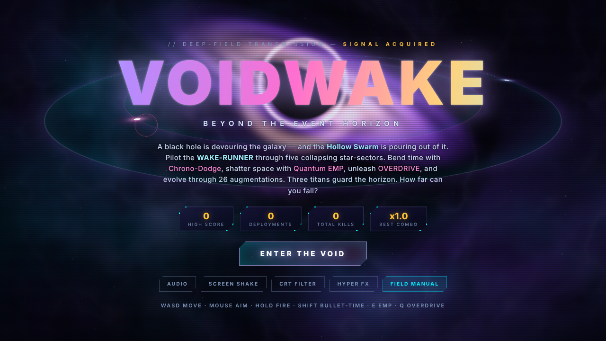
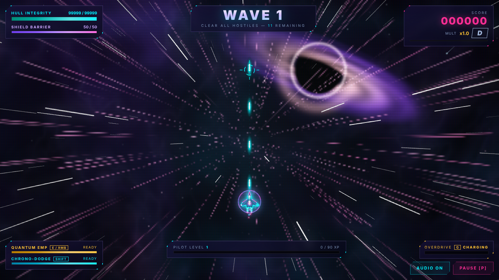
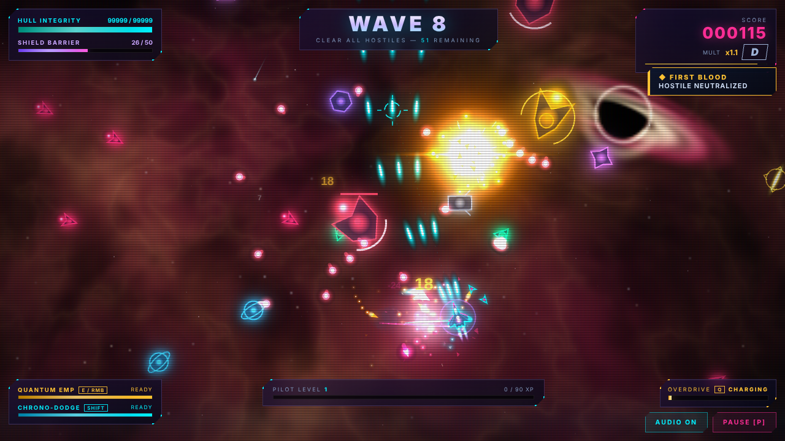
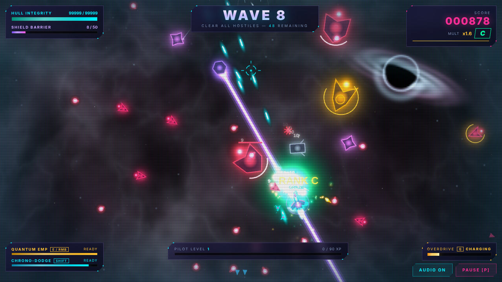
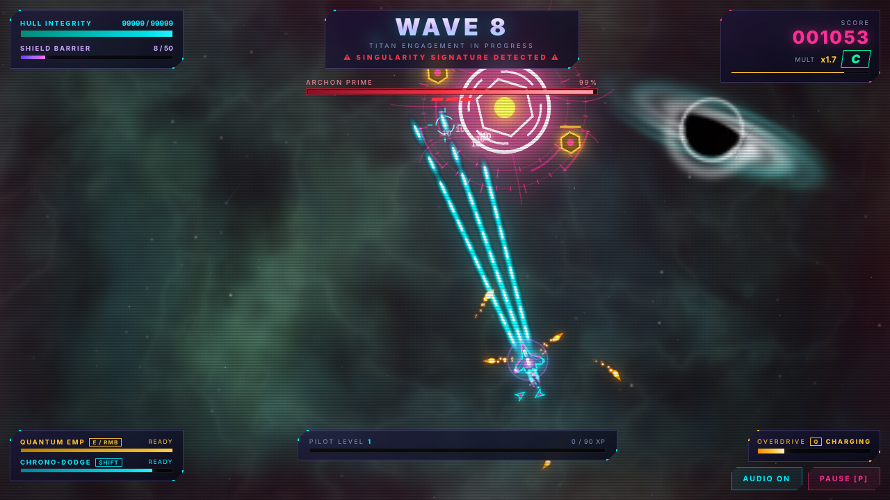

<div align="center">

# 🕳️ VOIDWAKE — *Beyond the Event Horizon*

**A single-file cosmic arcade shoot-em-up. Real-time black hole, live nebula shader, hyperspace jumps. Zero dependencies. One HTML file.**


**[▶ PLAY IN BROWSER — no install, no login](https://somersetnomad.github.io/voidwake/)**

*or download [`index.html`](index.html) and double-click it — works fully offline.*

</div>

---

<div align="center">

</div>

A black hole is devouring the galaxy — and the **Hollow Swarm** is pouring out of it. Pilot the **WAKE-RUNNER** through five collapsing star-sectors. Bend time with **Chrono-Dodge**, shatter space with **Quantum EMP**, unleash **OVERDRIVE**, and evolve your ship through 26 augmentations. Three titans guard the horizon. How far can you fall?

## 📸 Gallery

| | |
|---|---|
|  |  |
| *Hyperspace jump between waves* | *Ember Maw sector — plasma, rifts, bloom* |
|  |  |
| *Chrono-Dodge — the universe freezes cold* | *ARCHON PRIME and its sigil rings* |

## ✨ What's new in VOIDWAKE (v3.0)

| | Before (Cyber-Nexus v2) | **VOIDWAKE v3** |
|---|---|---|
| Background | Static gradient + grid floor | **Live WebGL cosmos**: domain-warped nebula, dust lanes, filaments, twinkling star fields |
| Centerpiece | Flat planet | **Real-time black hole** with gravitational lensing, Doppler-lit accretion disk and photon ring |
| Between waves | Banner | **Hyperspace jumps** — the stars streak to light-speed |
| World | One look | **5 star-sectors** (Iris Nebula → Ember Maw → Aurora Drift → Gilded Abyss → Null Corona) that recolor the whole galaxy |
| Glow | Per-shape shadow | **Full-screen bloom** pass |
| Explosions | Particles + ring | **White-hot flash, fireball, streaking debris, anamorphic lens flares**, sky pulses |
| Ship | Simple outline | **New WAKE-RUNNER**: shaded hull, twin plasma plumes, wing-tip light ribbons, nav lights, Fresnel shield, afterimages |
| Enemies | Outlines | **Lit cores, underglow, thrusters**, spawn as **dimensional rifts** |
| Titans | Shapes | **Rotating sigil rings, energy tendrils, aura**; the galaxy reddens around them |
| Chrono / Overdrive | Slow-mo | Universe **desaturates and ripples** / screen **burns gold** |
| Aiming | OS cursor | **Animated reticle with lock-on brackets** |
| UI | Neon panels | **Holographic title over the black hole**, orbiting rings, glassy violet HUD |

All gameplay — 9 enemy types, 3 titan bosses, 26 upgrades, combo ranks, graze/EMP/Overdrive, adaptive soundtrack, touch controls — is unchanged, and your old high scores carry over.

## 🎮 Controls

| Input | Action |
|---|---|
| `W A S D` / Arrow keys | Thrust |
| Mouse | Aim |
| `Space` / Hold Left Mouse | Fire |
| `E` / Right Mouse | **Quantum EMP** — shockwave that erases bullets & stuns |
| `Shift` (hold) | **Chrono-Dodge** — bullet-time; grazing builds energy |
| `Q` | **OVERDRIVE** — temporary weapon evolution |
| `1` `2` `3` | Pick upgrade card |
| `P` | Pause · `M` — Audio |

📱 **Touch supported** — virtual joystick + fire/EMP/dodge buttons appear automatically on mobile.

⚙️ **HYPER FX** toggle (menu or pause) switches the WebGL cosmos and bloom off for older machines. The shader also lowers its own resolution automatically if frames start running slow.

## 🛠️ Tech notes

- **Single self-contained `index.html`** — no framework, no bundler, no assets; all art is drawn in code, all audio synthesized live with the Web Audio API
- **Cosmos shader**: one full-screen GLSL fragment pass (fbm domain warping + lensing + accretion disk + hyperspace streaks) rendered at reduced resolution with dynamic scaling
- **Bloom**: quarter-res blurred copy of the game layer, added back additively
- Fixed-timestep loop with hit-stop & slow-mo, additive FX pass, glow-sprite cache
- Falls back to the original 2D background if WebGL isn't available
- Persistence via `localStorage`

## ▶️ Run it

```bash
git clone https://github.com/somersetnomad/voidwake.git
cd voidwake
python3 -m http.server 8080   # or: npx serve
# open http://localhost:8080
```

## 🌐 Host on GitHub Pages

1. Push this folder to a repo named `voidwake`
2. **Settings → Pages → Source: Deploy from a branch → `main` / `(root)` → Save**
3. Live at `https://somersetnomad.github.io/voidwake/`

## 📜 Changelog

- **v3.0 — VOIDWAKE** — renamed and visually rebuilt: WebGL cosmos with live black hole, hyperspace jumps, five color-shifting sectors, bloom, cinematic explosions, new ship, enemy rifts, titan sigils, reticle, holographic UI
- **v2.0 — Cyber-Nexus: Overdrive ULTRA** — 9 enemy types, 3 titans, 26 upgrades, combo ranks, procedural soundtrack, touch support
- **v1.0 — jam build**

## 📄 License

Released under the [MIT License](LICENSE).
